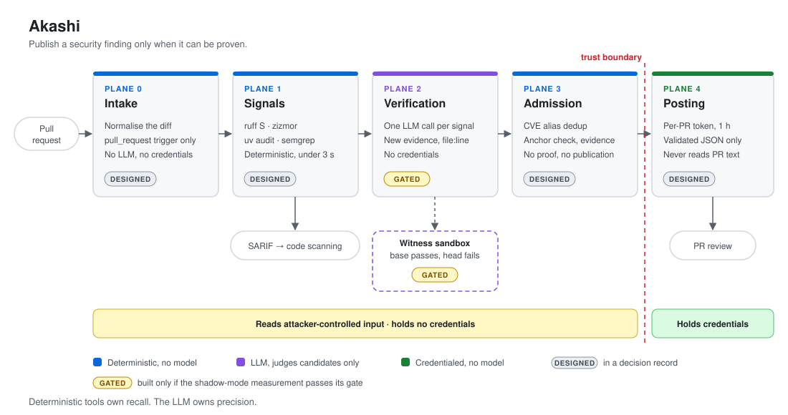

# Akashi

[](https://github.com/AlyonaCIA/akashi/actions/workflows/ci.yml)
[](LICENSE)

**Publish a security finding on a pull request only when it can be proven.**

*Akashi* (証) is Japanese for proof, evidence. AI code reviewers that flag everything get
muted, and a muted reviewer catches nothing. Akashi inverts the usual design: deterministic
tools generate candidates, a model judges them against new evidence, and an admission
layer discards anything that cannot be checked.



## How it works

| Plane | Role | Model | Credentials | Status |
|---|---|---|---|---|
| 0 · Intake | Normalise the diff; run only on `pull_request` | No | No | Designed |
| 1 · Signals | `ruff` security rules, `zizmor`, `uv audit`, `semgrep` on what the diff adds | No | No | Designed; prototype in Sentoru |
| 2 · Verification | Judge each signal: reachable, mitigated, introduced by this change | Yes | No | Gated on measurement |
| 3 · Admission | Deduplicate, validate anchors, require `file:line` evidence, cap output | No | No | Designed |
| 4 · Posting | Publish validated results with a short-lived, per-PR token | No | Yes | Designed |
| Witness sandbox | Run a test that passes on `base` and fails on `head` | No | No | Gated on measurement |

*Implemented* means merged here with tests. *Designed* means specified in a decision
record. *Gated on measurement* means it is built only if the shadow-mode gate in
[`CLAUDE.md`](CLAUDE.md) passes.

Two rules hold the design together:

- **Recall belongs to deterministic tools; precision belongs to the model.** The model
  never invents a finding, it only accepts or rejects a candidate.
- **The plane that reads attacker-controlled input never holds credentials.** Only
  schema-validated JSON crosses the trust boundary.

Hypotheses that come from the model also need a **witness**: a test that passes on `base`
and fails on `head`, executed in an isolated sandbox. The sandbox is built only if
measurement shows enough hypotheses can be witnessed.

## Invariants

Guarantees enforced by tests that run in CI. Each test is proven to fail on a workflow
that breaks it.

| Invariant | Enforced by |
|---|---|
| No workflow uses `pull_request_target` | `zizmor` (`dangerous-triggers`), checked live in [`tests/policy/test_workflows.py`](tests/policy/test_workflows.py) |
| Every action is pinned to a full commit SHA | `zizmor` (`unpinned-uses`), checked live in the same test |
| Every workflow starts from `permissions: {}` | [`tests/policy/test_workflows.py`](tests/policy/test_workflows.py) |
| Every job has a timeout | [`tests/policy/test_workflows.py`](tests/policy/test_workflows.py) |
| No job triggered by attacker-influenced content references `secrets.*`, so no job holds untrusted text and secrets at once | [`tests/policy/test_workflows.py`](tests/policy/test_workflows.py) |

Not covered: permissions and secrets inherited by reusable workflows, composite
actions, and repository or organisation settings outside the YAML.

## Architecture decisions

The design is recorded in [`docs/architecture/`](docs/architecture/): the target
architecture, the evidence behind every figure, and one record per decision.

| ADR | Decision |
|---|---|
| [0001](docs/architecture/decisions/0001-deterministic-recall-llm-precision.md) | A deterministic pass owns recall; the LLM owns precision |
| [0002](docs/architecture/decisions/0002-phases-over-roles.md) | Phases and context partitioning, not agent roles |
| [0003](docs/architecture/decisions/0003-differential-security-tests.md) | Differential security tests replace generated penetration tests |
| [0004](docs/architecture/decisions/0004-untrusted-input-isolation.md) | Privilege separation between components that read hostile input |
| [0005](docs/architecture/decisions/0005-finding-admission.md) | Deterministic admission and prioritisation before publication |
| [0006](docs/architecture/decisions/0006-cwe-scope-restriction.md) | Restrict scope by CWE class |
| [0007](docs/architecture/decisions/0007-deterministic-toolchain.md) | Toolchain for the deterministic signal pass |

## Status

Repository, CI/CD and workflow policy are in place. No plane is implemented here
yet; Plane 1 migrates from Sentoru next.

## Development

Requires [uv](https://docs.astral.sh/uv/).

```sh
uv sync
uv run pytest
uv run ruff check . && uv run ruff format --check .
uv run pyright
```

## CI/CD

- **CI** (`ci.yml`) on every pull request and on `main`: lint, strict type check, tests
  on Python 3.12–3.14 with coverage, workflow security (`actionlint`, `zizmor`), and a
  build smoke test. `CI success` aggregates every job.
- **Release** (`release.yml`) on a `vX.Y.Z` tag matching the project version: builds the
  distributions, attests their provenance, and publishes a GitHub release.
- **Dependency review** on every pull request blocks new dependencies with known
  vulnerabilities of moderate severity or higher.
- **CodeQL** analyses Python and the workflows (`security-extended`) on pull requests, on
  `main` and weekly, and reports to code scanning.
- **Dependabot** updates GitHub Actions and Python dependencies weekly, after a seven-day
  cooldown.

All actions are pinned by commit SHA, and every job receives only the permissions it
needs.

## Origin

Akashi continues [Sentoru](https://github.com/Jorgelmh/sentoru-agent), by Jorge Mendez,
Lena Araujo and Juan Camilo Guevara. See [NOTICE](NOTICE).

## License

[Apache 2.0](LICENSE)
